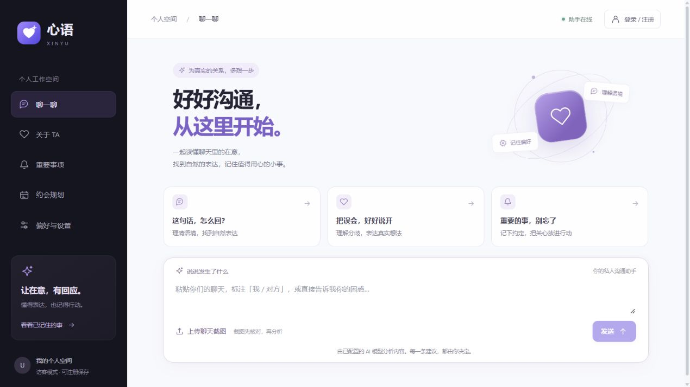

# 心语 Xinyu

帮助现实情侣理清沟通、生成自然回复、记住伴侣偏好并跟进重要事项的私人 AI 助手。



## 可以做什么

- 粘贴聊天，获得分析和可自行编辑、复制的回复建议。
- 上传聊天截图，用 GLM-5.3-FlashX 转录，核对双方身份和文字后再分析。
- 确认保存伴侣偏好；按问题检索相关记忆，支持修改与删除。
- 设置重要事项，后台到期生成提醒记录，支持改期、完成和取消。
- 输入区域、时间、预算与限制，结合偏好生成约会参考方案并保存。
- 注册账号保留访客记录，在连接同一后端的其他设备登录使用。
- 一次性图形验证码、登录失败锁定、登录设备管理、修改密码和最近安全动态。
- 绑定已验证邮箱、SMTP 后台发送验证码、通过邮箱重置密码并撤销旧会话。
- 身份验证后注销账号并查看后台清理回执；对咨询建议提交、修改或删除反馈。
- 取消任务、故障退避重试、用量预算展示；列表分页和按需查看聊天原文。
- 主动导入 UTF-8 TXT/JSON 聊天，或导出本空间的数据。
- 用语义与关键词混合检索找回偏好、聊天原文，查看索引状态与回答来源。
- 查看 LangGraph 实际执行步骤，失败任务可基于 PostgreSQL 检查点恢复。

网页基础版已经接通真实模型及工具调用。个人微信按当前开发范围准备授权、文本收发与提醒投递接口，尚未进行真实账号授权联调。系统通知需要打开网页；关闭网页后的外部推送需另行连接微信。没有自动读取其他私聊、自动预订、支付或模型微调。

## 技术结构

- 前端：React、TypeScript、Vite、React Router。
- 后端：FastAPI、Pydantic、SQLAlchemy、Alembic、PostgreSQL。
- Agent：LangGraph 状态图、条件工具循环、Pydantic 结构校验、PostgreSQL 检查点恢复。
- RAG：LangChain 中文分块、本地 FastEmbed/BGE 中文向量、Qdrant、BM25、RRF 融合与 GLM 语义重排。
- 后台：独立 Worker 与 PostgreSQL 持久任务队列、提醒收件箱。
- 账号：scrypt 密码哈希、随机 HttpOnly/SameSite 会话；Redis 验证码、限流、失败锁定与会话撤销；SMTP 验证邮箱与密码找回。

## 启动

本地 `.env` 按 `.env.example` 填写数据库、Redis、Qdrant 和模型配置，不要提交 API Key。需要 Python 3.12、Node.js、pnpm、PostgreSQL、Redis 和 Qdrant。本地中文 Embedding 不需要额外 API Key，模型缓存默认位于 D 盘。

已有的 Windows 本地环境可以运行：

```powershell
Set-Location -LiteralPath 'D:\Study\简历\Xinyu'
.\scripts\start.ps1
```

启动脚本使用本机 D:\DevTools 的运行时，启动 PostgreSQL、Redis、Qdrant、API、Worker 与前端。打开 [心语](http://localhost:5173/assistant)。停止应用进程运行 `.\scripts\stop.ps1`，数据库及数据卷保留。新机器首次运行需要先按下方命令下载 Embedding 模型。

手动启动时，在独立终端运行 API、Worker 和前端；前端命令在 `admin-ui` 目录内执行：

```text
uv sync
docker compose up -d --wait postgres redis qdrant
uv run alembic upgrade head
uv run python -m scripts.prepare_ai --download-model
uv run uvicorn app.main:app --host 127.0.0.1 --port 8000
uv run python -m scripts.worker
pnpm install --frozen-lockfile
pnpm dev
```

默认仅本机访问，跨设备需要连接同一服务，并正确配置网络、HTTPS和访问控制后使用。

## 配置与说明

截图可以复用文本模型平台的地址和 Key，也可用 `RELATIONSHIP_VISION_BASE_URL`、`RELATIONSHIP_VISION_API_KEY` 配置独立服务。当前视觉模型为 `glm-5.3-flashx`。

`.env`、`.runtime`、数据库内容和微信密钥不进入 Git。数据库、私有运行文件和加密密钥应一并备份。

- [功能、接口与验收范围](./docs/relationship-mvp.md)
- [界面说明](./docs/xinyu-ui.md)
- [项目名称与本地环境](./docs/project-name.md)
- [数据库升级与归档](./docs/database-upgrades.md)
- [账号验证与 Redis](./docs/account-security.md)
- [RAG、向量检索与 LangGraph](./docs/rag-langgraph.md)
- [邮箱绑定与密码找回](./docs/email-recovery.md)
- [账号注销、清理回执与反馈](./docs/account-closure-feedback.md)
- [任务控制、用量与分页读取](./docs/task-controls.md)
- [模型资源等待与崩溃恢复](./docs/model-capacity-recovery.md)
- [HTTP、队列与 Agent 链路实测](./docs/pipeline-performance.md)
- [工程化完整范围与进度](./docs/enterprise-readiness.md)
- [运行状态、日志与告警](./docs/observability.md)
- [Agent 质量评测与版本比较](./docs/agent-evaluation.md)
- [AI 数据处理选择与保留期限](./docs/privacy-retention.md)
- [加密备份与隔离恢复演练](./docs/backup-recovery.md)
- [检索复用、本机性能与容量边界](./docs/retrieval-performance.md)

仓库：[drbcxe/Xinyu](https://github.com/drbcxe/Xinyu)。
