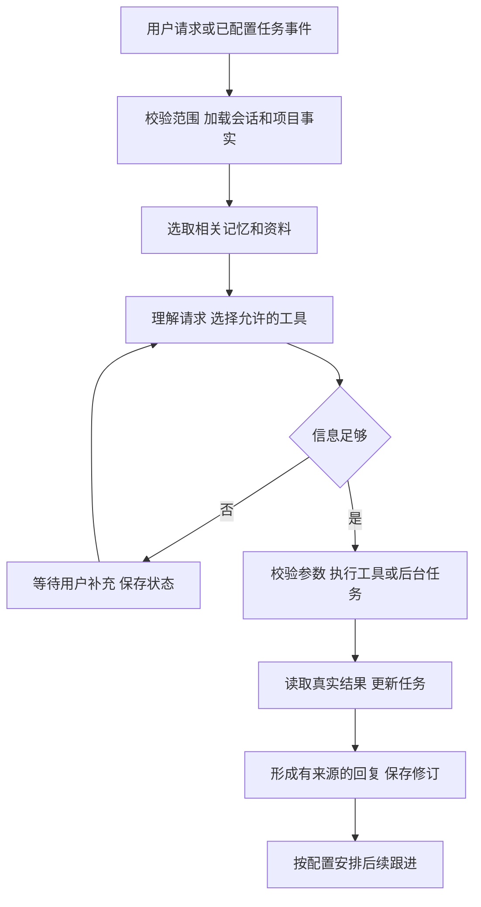

# 心语 Xinyu

帮助现实情侣理清沟通、生成自然回复、记住伴侣偏好并跟进重要事项的私人 AI 助手。

**当前阶段：网页基础版可用；微信按当前范围完成接口准备，尚未授权联调。**


2026-10-26 起，项目由科研助手转向现实情侣沟通场景，正式名称为「心语 Xinyu」，Python 项目名为 `xinyu`，前端包名为 `xinyu-web`。打开 [心语](http://localhost:5173/assistant)：粘贴聊天或上传截图，核对转录后获取建议，确认保存伴侣偏好，安排重要事项及约会参考方案。

已实现账号注册与跨浏览器登录、真实模型工具调用、相关记忆检索、后台任务、提醒收件箱、TXT/JSON 聊天导入、数据导出和约会方案保存。视觉模型使用 `glm-5.3-flashx`，可单独配置模型服务。后台提醒不依赖网页打开；系统通知仍需要网页打开，关闭网页后的外部推送需要另行连接微信。

本地目录：`D:\Study\简历\Xinyu`。GitHub：[drbcxe/Xinyu](https://github.com/drbcxe/Xinyu)。Docker 项目标识与数据库用户继续保留 `researchmate`，用于兼容原有数据。详见 [名称调整记录](./docs/project-name.md)。

## 启动网页基础版

本地 `.env` 按 `.env.example` 填写数据库连接与模型参数；不要提交 API Key。项目依赖 Python 3.12、Node.js、pnpm 和 PostgreSQL。已有开发环境可运行：

```powershell
Set-Location -LiteralPath 'D:\Study\简历\Xinyu'
.\scripts\start.ps1
```

Windows 启动脚本使用本机 `D:\DevTools` 的运行时，启动 FastAPI、独立 Worker、Vite，并复用现有 Docker PostgreSQL/Redis。停止应用进程运行 `.\scripts\stop.ps1`，数据库容器和数据卷会保留。

也可在不同终端分别运行以下命令（前端命令在 `admin-ui` 内执行）：

```text
uv sync
uv run alembic upgrade head
uv run uvicorn app.main:app --host 127.0.0.1 --port 8000
uv run python -m scripts.worker
pnpm install --frozen-lockfile
pnpm dev
```

功能范围和真实验收记录见 [网页基础版说明](./docs/relationship-mvp.md)。旧科研模块仍可从 `/projects` 进入；新恋爱模块使用独立的工具循环和数据表，未训练模型。此版本默认仅本机访问，原科研接口尚未新增账号认证。

<details>
<summary>历史科研方向的设计与开发记录（原名 ResearchMate）</summary>

---

**ResearchMate（研伴）：科研项目协作 Agent**

**当前开发入口：[每天约8小时的七天开发清单](./7天开发清单/README.md)**。包含每日前后端任务、LovAgent 源码对照、Git/GitHub 操作、Docker 部署与20项系统验收；由你亲手实现七天 v0.1。下文保留完整产品与后续扩展设计。

**今天开始：[Day 1 逐步实操](./7天开发清单/Day01-逐步实操.md)**，需要代码参照时看 [Day 1 最小示例](./7天开发清单/Day01-最小代码示例.md)。

设计日期：2026-10-20。定位：服务机器学习研究生和个人研发者，持续记住一个项目的背景、比较实验结果、执行受控工具，并按配置跟进任务。

当前状态：已实现项目、CSV、实验比较、真实 GLM 工具调用 Agent 对话和跨会话项目偏好。独立聊天页支持新建/切换会话、多轮上下文、实际工具步骤和有来源的比较卡片；项目偏好页支持设置、修改、停用和查看修订记录。业务数据保存到 PostgreSQL，LangGraph 状态保存到独立的 agent_checkpoints schema，原始 CSV 保存到项目 `.runtime/artifacts`。登录、后台任务、待办、提醒、SSE 和 MCP 尚未实现。示例数据完全为合成数据，数值不属于用户研究成果。

**当前后端启动方式**（从项目根目录执行，先在本地 `.env` 配置 `DATABASE_URL`）：

```powershell
docker compose up -d --wait postgres redis
uv run alembic upgrade head
uv run python scripts/init_checkpointer.py
uv run uvicorn app.main:app --reload --host 127.0.0.1 --port 8000
```

打开 `http://127.0.0.1:8000/docs`。`POST /api/projects` 接收 `id`、`name`、`description`，成功返回 201；`GET /api/projects` 返回 `{items:[...]}`。编号以大写字母开头，最多 32 字符，其余字符允许大写字母、数字、下划线和连字符。重复编号返回 409 `PROJECT_EXISTS`，参数错误返回 422 `VALIDATION_ERROR`。

前端从 `admin-ui` 目录运行 `pnpm.cmd dev`，打开 `http://localhost:5173`，自动跳到 `/projects`。页面使用 React Router，项目范围由网址中的 `projectId` 确定，可直接打开、刷新、前进或后退。前端通过 Vite 的 `/api` 代理访问后端，开发时需要同时运行前后端。

| 页面 | 地址 | 职责 |
|---|---|---|
| 项目列表 | `/projects` | 浏览项目，点击进入工作台 |
| 新建项目 | `/projects/new` | 填写资料，成功后跳到新项目工作台 |
| 项目工作台 | `/projects/:projectId` | 项目背景，以及文件、比较入口 |
| Agent 对话 | `/projects/:projectId/chat?thread=:threadId&artifact=:artifactId` | 自然语言提问、真实工具执行、消息和来源恢复 |
| 项目偏好 | `/projects/:projectId/memories` | 查看、修订、停用偏好，追溯版本与聊天来源 |
| 文件与实验 | `/projects/:projectId/files` | 上传 CSV、浏览文件；上传成功跳到文件详情 |
| 实验详情 | `/projects/:projectId/files/:artifactId` | 展示指定文件的实验表和来源，可进入比较页 |
| 实验比较 | `/projects/:projectId/comparisons?artifact=:artifactId` | 选择文件、比较实验、查看历史结果 |
| 系统概览 | `/overview` | 健康与模型配置状态 |

各页共享侧栏、面包屑；项目内显示工作台、Agent 对话、文件与实验、实验比较导航。无效页面有 404 返回入口，项目或文件读取失败可重试。独立详情页通过 `GET /api/projects/{project_id}` 和 `GET /api/projects/{project_id}/artifacts/{artifact_id}` 读取资料，后端继续检查项目归属。后续生产托管需要支持前端地址回退到 `index.html`，并保留 `/api` 的真实错误响应。

**与 Agent 对话**：进入项目内“Agent 对话”，新建会话并选择实验文件，输入“以 R001 为基线，比较 R002 的改善幅度”。模型使用 function calling 自主选择 `get_project_context`、`list_runs`、`compare_runs`，LangGraph 执行 context_loading → generation → tools → generation 循环。比较工具调用同一业务服务，成功结果直接作为聊天中的比较卡片；业务拒绝作为结构化工具结果交回模型解释。项目、会话、当前文件和执行 ID 从后端上下文注入，不接受模型指定宿主机路径或切换项目范围。

模型配置继续读取 `.env` 的 `MODEL_BASE_URL`、`MODEL_NAME` 和 `MODEL_API_KEY`。GLM 适配通过 HTTPX 保留 `reasoning_content` 等消息字段和 tool_call_id 配对；仅答复、工具事件及证据返回页面，内部推理不展示。可选配置 `MODEL_TIMEOUT_SECONDS=60`、`MODEL_MAX_TOKENS=4096`、`AGENT_TIMEOUT_SECONDS=300`。每轮最多 6 次工具调用，暂时性模型错误全轮最多重试 2 次；超过预算或出现系统错误会保存真实失败状态，不用固定回答冒充模型成功。

**跨会话项目偏好**：可以说“记住，这个项目默认以 R001 为基线，回复请简短”，由 `get_project_preferences` 和 `revise_memory` 读取版本并真实保存。仅支持默认基线、关注指标、回复长度（简短/适中/详细）和报告语言（中文/英文）。后端验证来源逐字来自当前真实用户消息，并保留 source_message_id；普通讨论不应自动记忆。每次模型调用都从数据库加载当前项目的最新版本，停用值不加入偏好召回。旧聊天仍保留，不代表旧值继续生效。默认基线仍需在当前文件存在且满足比较条件，偏好不能改变实验事实。详见 [项目偏好开发记录](docs/day04-memory.md)。

偏好接口：`GET /api/projects/{project_id}/memories`、`PUT /memories/{key}`（value、expected_revision，首次为 0）、`POST /memories/{key}/deactivate`（expected_revision）、`GET /memories/{key}/history`（最近 50 版本）。修改和停用均创建新修订；项目行锁与版本号避免并发覆盖，过时版本返回 409 `REVISION_CONFLICT`。停用仅停止召回，保留聊天、来源与审计记录。当前仍是本机单用户开发阶段，Day 4 的登录与 interrupt/resume 流程另行实现。

会话、消息、AgentRun 和 RunEvent 是业务表，由 Alembic 迁移；LangGraph 表由幂等脚本 `scripts/init_checkpointer.py` 单独初始化，置于 `agent_checkpoints` schema，避免业务迁移误删。页面读取最近 60 条消息；图上下文保留最近最多 4 个完整工具交互回合并限制历史大小，数据库不因此删除旧消息。相同会话的 request_id 去重，不同内容复用编号返回 REQUEST_ID_CONFLICT；同会话同时执行第二条消息返回 THREAD_BUSY。Agent 比较使用 run_id＋tool_call_id 去重并关联结果。执行进程异常中断后，超过租约的 running 记录在读取会话或继续提交时标为失败，保留已经完成的比较结果。

当前 POST runs 在同步路由执行图后返回 `{run_id,status}`；聊天页在等待期间每 1.5 秒读取消息和持久化事件，展示真实工具进度，SSE 后续再接。前端连接中断时“恢复本次请求”沿用原 request_id。模型平台认证、权限、配额和连接错误会明确显示。真实 API 演示记录见 [Agent 接入记录](./docs/day03-agent.md)。

**上传实验 CSV**：进入项目工作台，打开“文件与实验”。可以下载合成演示 CSV；其每行 `project_id` 为 `P001`，应先创建并进入 `P001`。也可直接上传 `examples/runs_demo.csv`。导入成功跳到文件详情，显示 R001/R002/R003、原始指标字符串、评估口径和 CSV 行号；R003 使用不同的评估协议，不能与 R001 直接比较。

文件要求：UTF-8 或 UTF-8 BOM、`.csv`、最多 5 MiB、1—10000 条记录，所有必需字段非空；同文件内 `run_id` 唯一，`optimization` 只能为 `min` 或 `max`，`metric_value` 必须是允许范围内的有限数值，每行项目编号必须等于所选项目。必需列如下：

```text
run_id,project_id,model_name,dataset_version,split_id,protocol_version,metric_name,metric_unit,optimization,metric_value,seed
```

`POST /api/projects/{project_id}/artifacts` 使用 multipart 字段 `file`，首次导入返回 201，响应包含 `id`、`project_id`、`original_name`、`sha256`、`size_bytes`、`row_count`、`created_at`、`reused`。同一项目内相同原始字节内容按 SHA256 去重，复用时返回 200 与 `reused:true`，保留原文件名称；内容发生变化会产生新记录。`GET /api/projects/{project_id}/artifacts` 返回 `{items:[...]}`；`GET /api/projects/{project_id}/artifacts/{artifact_id}/runs` 返回实验列表，同样使用 `{items:[...]}`，并校验文件的项目归属。

整个 CSV 校验通过后才保存文件、在同一数据库事务中写入文件和全部实验。原文件使用应用生成的 UUID 文件名保存，上传临时目录为 `.runtime/upload-tmp`，当前工作区两者均在 D 盘。不要将 `.runtime`、真实数据或 `.env` 提交到 Git。数据库与原文件需要一同保留；事务提交结果不明确时保留原文件，避免删除可能已提交记录的来源文件。

**比较实验**：从文件详情点击“比较此文件中的实验”，或通过项目内“实验比较”导航进入，选择文件后使用“比较两组实验”表单选择基线和候选。当前文件 ID 保存在查询参数 `artifact` 中。后端复用 `tools.compare_runs.compare_runs` 进行 Decimal 计算，再校验本次计算所用文件的 SHA256 与上传记录相同，成功才保存比较记录。页面展示原始数值、差值、按指标优化方向计算的改善量、相对改善率、ECharts 柱状图和来源明细。图表按统一比例绘制；精确数值与改善率使用后端结果，前端不重新计算业务结论。

演示数据中，R001 → R002 的 RMSE 从 0.50 变为 0.45，绝对改善 0.05、相对改善 10%；R001 → R003 返回 422 `INCOMPARABLE_RUNS`，页面列出 `split_id` 和 `protocol_version` 的差异。同实验返回 `SAME_RUN`；缺少原文件、原文件大小或哈希发生变化时拒绝生成结果。基线为零或负数时相对改善率为 null，仅展示绝对变化，不推断统计显著性或总体最优。

`POST /api/projects/{project_id}/comparisons` 接收 `{artifact_id,baseline_run_id,candidate_run_id}`，成功返回 201，包含 `id`、`project_id`、`artifact_id`、`created_at`、`status`、`metric`、`baseline`、`candidate`、`comparison`、`provenance`。响应及持久化结果不包含宿主机文件路径。`GET /api/projects/{project_id}/comparisons?artifact_id=...` 返回当前文件最近 20 条成功结果 `{items:[...]}`，页面点击历史记录可恢复显示；`GET /api/projects/{project_id}/comparisons/{comparison_id}` 查询一条已保存结果。查询均检查项目范围。当前比较功能不调用大模型。

**1．为什么这个方向适合你**

依据当前工作区记录：你了解 Python，已有 PyTorch 推理代码与权重，研究涉及多变量时序建模和矿物组分估计，希望学习完整 Agent 工作链路与 Git/PR/CI/部署。

这个项目把你每天能接触的数据、实验结果和项目背景变成真实素材。第一使用者是你本人，是否解决问题可通过日常使用验证。现有研究模型作为后续工具接入，主流程持续支持交流、记录、查询、执行与跟进。

首个业务场景限定为“实验复盘与下一步跟进”。检索论文、撰写论文、自动改代码、自动训练、团队权限和外部通知暂留后续范围。项目价值假设尚未经过企业访谈或真实效率测量。

**2．一句具体的使用请求**

> 我在准备本周组会。帮我比较这个项目的 baseline 和 candidate 实验，记住我报告结果时先看 RMSE。把需要补充的验证记成待办，明天 9 点在站内提醒我检查进展。

系统需要先确认项目与实验对应关系，使用实际数据比较，分别保存偏好与任务，再在明确时刻产生可追溯提醒。组会日期缺失时应追问，不凭“本周”自行创建截止时间。

不同对话入口还可以处理：

- “接着昨天那个消融实验，我们做到哪了？”——加载项目事实、任务和相关记忆。
- “那一组比 baseline 改善多少？”——有歧义时先定位 run ID，指标由程序计算。
- “补一个跨随机种子的实验计划。”——生成带状态的计划草稿，未运行的实验标为未执行。
- “结果出来了，帮我更新进展。”——登记新结果，关联原任务，保留旧版本。
- “今天先不提醒了，改成后天上午十点。”——更新指定提醒，旧版本后续不再触发。

这些是目标行为，尚不是已运行演示。

**3．第一版的完整业务故事**

1. 创建项目 P001，录入目标、数据范围、基线和已有实验。
2. 上传经过显式映射的实验结果 CSV，保存为不可变数据版本。
3. 用户提问；Agent 解析任务与指代，加载必要上下文。
4. 调用比较工具，核查项目、数据版本、划分、评估协议、指标、单位和随机种子。
5. 返回比较结果，注明源文件、run ID 和来源行。条件不一致时解释哪些字段不同。
6. 用户可把后续验证要求登记为任务；真实执行与计划条目分别保存。
7. 用户配置提醒后，到期生成站内消息；若任务已完成或取消，按配置停止相应跟进。
8. 次日新会话仍能查询项目状态，修改偏好或纠正事实。

成功标准：隔天回来，可以正确接续项目，并从回答定位到真实任务与实验记录。

**4．借鉴 LovAgent 的方式**

| LovAgent 的需求 | ResearchMate 的对应设计 |
|---|---|
| 稳定角色 | 稳定的研发协作角色与输出偏好 |
| 聊天上下文 | 当前讨论的项目、实验和任务引用 |
| 用户长期记忆 | 用户偏好与项目背景，保留来源及修订 |
| 情绪回应 | 按用户时间、目标与进度调整信息量；首版不实现情绪评分 |
| 主动问候 | 明确到期任务、运行完成和约定检查点触发跟进 |
| 联网搜索 | 先检索项目内方法文档；公开检索后续再接 |
| 消息交付 | 首版站内通知，有状态、事件 ID 和重复处理记录 |

业务角色提示词可以是：“你帮助用户持续推进已登记的研发项目。优先查询项目事实和工具结果；缺少实验数据时明确说明。建议、计划、已执行结果分别表达。”

Prompt 是行为指导，项目范围、参数校验、数据写入和结果状态由程序约束。

**5．第一版模块与页面**

| 模块 | 必须实现的行为 |
|---|---|
| 项目对话 | 选定项目、多轮指代、SSE 展示工具与状态、跨重启恢复 |
| 记忆 | 保存偏好与有来源的背景，可查看、修订、删除 |
| 实验结果 | 登记 CSV、比较同口径结果、返回来源 |
| 任务 | 草稿、待补充、排队、执行、成功、失败、取消等状态按用途区分 |
| 提醒 | Asia/Shanghai 时区、到期执行、修改/取消、交付记录 |
| 运行记录 | 请求 → graph run → tool call → task → result 的关联 |

页面采用一个工作台：左侧项目列表，中间对话，右侧显示当前任务、关联结果与待确认信息。结果详情和记忆编辑从右侧打开，首版不建复杂门户。

前端可以展示用户能理解的“正在读取结果”“需要补充评估协议”；内部堆栈和框架细节放入开发 trace。

**6．Agent 的执行结构**



模型负责理解自然语言、选择允许的工具、整理有依据的说明。程序负责比较计算、任务状态、幂等、范围检查和交付。

建议第一版限制每次请求最多 6 次工具调用；可重试的暂时性错误最多重试 2 次。这些是应用设计值，需要实测后调整。明确的输入错误、口径不一致与不兼容模型直接返回可解释结果。

**7．四种数据必须分清**

| 类型 | 例子 | 存放与修改原则 |
|---|---|---|
| 会话状态 | “那一组”当前指向 R002 | graph checkpoint，可恢复 |
| 偏好记忆 | 喜欢简洁回答、优先看 RMSE | 跨会话存储，可纠正与删除 |
| 项目事实 | 数据版本、评估划分、模型适用范围 | 独立业务表、来源与版本，不由摘要覆盖 |
| 执行结果 | 某次工具输出、任务成功或失败 | 由真实执行产生，关联任务与输入版本 |

模型提出的原因解释属于假设或建议，不能自动写入“实验已证明的结论”。

LangGraph 官方把 thread 内状态的 checkpointer 与跨 thread 的 store 分开；这里继续把实验与任务事实维护为独立业务记录。[持久化文档](https://docs.langchain.com/oss/python/langgraph/persistence)

**8．技术路线与引入顺序**

完整技术目标包括持续对话、记忆、工具/MCP、任务恢复、检索、研究服务与工程交付；七天 v0.1 的具体范围和后续扩展以 [七天开发清单](./7天开发清单/README.md) 为执行入口。依赖按实施时稳定版本验证与锁定。

| 阶段 | 组件 | 实际用途 |
|---|---|---|
| 起步 | Python、uv、标准化 CSV、pytest/Ruff | 先验证比较工具、输入契约与错误行为 |
| 对话闭环 | FastAPI、Pydantic、LangGraph、PostgreSQL、SQLAlchemy/Alembic | 对话、工具调用、checkpoint、记忆和事实 |
| 页面与跟进 | React/TS/Vite、SSE、Celery/Redis | 工作台、后台任务、到期扫描、站内通知 |
| 扩展 | pgvector、MCP SDK、独立 PyTorch 服务 | 项目资料检索和专业工具 |
| 交付 | Langfuse、Playwright、Docker Compose、GitHub Actions | trace、关键行为回归与复现 |

后端和前端依赖已分别记录在 `pyproject.toml`/`uv.lock` 与 `admin-ui/package.json`/`admin-ui/pnpm-lock.yaml`；后续依赖变更应同步提交锁文件。

本地开发使用 Windows、uv 管理的 Python 虚拟环境和 Docker Desktop Linux 容器。运行数据库功能前需启动 Docker Desktop。后续 Celery worker 在 Linux 容器或 WSL2 中运行，官方当前不支持原生 Windows。[Celery FAQ](https://docs.celeryq.dev/en/stable/faq.html)

研究模型继续使用其已验证的环境，通过独立服务接入。

**9．第一版与后续范围**

第一版围绕：一个本地用户、两个项目用于检查串项目问题、一种规范化 CSV、一个指标比较工具、偏好记忆、任务和站内提醒。单用户演示不宣称实现生产鉴权或团队权限；project_id 是业务范围字段，不能代替身份认证。

专业扩展先选择一个你确实能运行的模型。GRAIL 工具只接受其已验证数据域、频率、变量、预处理与窗口；矿物模型使用自己的输入输出契约。文件同为 CSV，不代表模型可互换。

后续再加入项目方法文档检索、MCP 实际 server/client 调用、一个研究模型服务，以及固定评测集和部署流程。首版不要求接完所有研究。

**10．你自己的贡献应怎样形成**

- 研发项目的任务、实验与事实数据模型。
- 可纠正、可追溯的项目记忆。
- 实验可比性检查与有来源的数值结果。
- 带状态、重复处理和恢复测试的任务跟进。
- 已有研究模型的工程适配与推理一致性验证。
- 固定案例下的工具正确性、记忆使用、恢复行为与实际开销。

这些能力完成并实测后，才进入简历。当前研究精度不能直接当成本应用的效果指标。

**11．目录入口**

- [工具与状态契约](./工具与状态契约.md)
- [七个开发关卡](./开发关卡.md)
- [合成实验结果](./examples/runs_demo.csv)
- [首个可运行工具](./tools/compare_runs.py)
- [工具测试](./tests/test_compare_runs.py)
- [起步工具验证记录](./验证记录.md)
- [待执行的 Agent 验收案例](./evals/scenarios.json)

在本目录运行首个工具：

```powershell
python -X utf8 -m tools.compare_runs --csv examples/runs_demo.csv --project P001 --baseline R001 --candidate R002
python -X utf8 -m unittest discover -s tests -v
```

成功用例会给出合成数据中 RMSE 从 0.50 到 0.45、改善 10% 的计算结果与来源行；这只演示工具算法。将 candidate 改为 R003 会因划分与协议不同而拒绝比较，命令退出码为 2。

</details>
