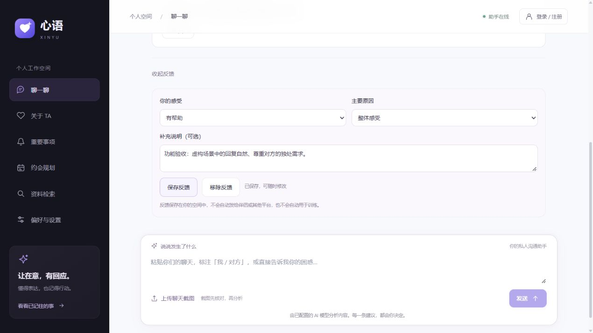

# 账号注销、清理回执与反馈

## 使用入口

- 登录后的“账号管理 → 注销账号与在线内容”：输入当前密码、图形验证码和“注销账号”确认文字。可以先返回设置页导出数据。
- 每条咨询结果底部“这次建议有帮助吗”：选择评价、原因和可选说明，保存后可再次修改或移除。反馈不会自动发送给伴侣、模型平台，也不自动用于训练。

## 注销范围

身份验证后，API 撤销所有登录会话，并在同一次业务事务中删除账号、资料设置、咨询、排队任务、事项、提醒、导入记录、反馈、邮箱验证记录、安全动态及微信授权。检索索引使用持久删除任务在后台移除；清理失败会保留任务以便重试。

为阻止注册前的旧访客 Cookie 重新取得原空间，系统保存不含聊天或联系方式的空间关闭标记。模型用量与防滥用计数保留原有记账，不能通过清空或注销重置预算；完整保留期限和备份删除策略属于后续工程化工作，尚不能声明所有存储介质已彻底擦除。

正在执行的旧任务会失去执行权，不能再次保存咨询结果；图检查点会立即清理，并由任务结束和后台维护再次清理。空间清理使用服务器生成的空间前缀批量删除三个图数据表，包含没有对应检查点行的残留 blob / write，同时保护其他空间。

接口返回不可猜测的注销回执，数据库只保存其哈希。账号注销后可继续查询该回执；后台只有在已登记索引删除任务消失、图检查点为空且旧任务安全等待窗口结束后才将回执标为完成。默认窗口由 Agent / 模型超时配置计算，界面不会把注销接口返回误报成所有副本已清理完成。

在线清理不等于供应商留存或已有备份清理。不得把“注销成功”解释为已经删除模型服务商接收的内容，也没有撤销已发出的网络请求。正式备份与恢复流程、保留期限、删除记录恢复后的再应用仍在后续清单中。

## 接口

| 接口 | 用途 |
| --- | --- |
| `DELETE /api/relationship/auth/account` | 身份确认后注销，返回清理回执 |
| `POST /api/relationship/privacy/deletion/status` | 在 JSON 中提交回执查询状态，避免把回执放入 URL |
| `GET /api/relationship/feedback/{turn_id}` | 读取自己咨询的反馈 |
| `PUT /api/relationship/feedback/{turn_id}` | 幂等保存或更新反馈 |
| `DELETE /api/relationship/feedback/{turn_id}` | 移除自己的反馈 |

每个空间每条咨询最多一份反馈，必须先验证咨询归属。反馈纳入数据导出，也随清空历史或账号注销一并删除。注销和反馈修改受来源校验、身份校验及限流约束。

## 验证

`tests/test_account_closure_feedback.py` 使用独立 PostgreSQL / Redis 环境，覆盖反馈隔离与导出、修改与删除、清空历史关联删除、密码验证、注销后旧会话与旧访客 Cookie 失效、运行中的模型任务无法重建数据、索引删除回执及跨空间检查点清理。模型生成与向量服务在这些确定性检查中被隔离模拟，数据库和图持久化真实运行。

网页另以明确标注的虚构咨询场景验证反馈保存，未注销用户实际账号。界面效果见下图。

