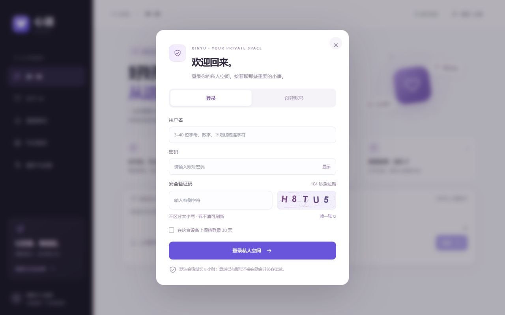

# 账号验证与 Redis

更新：2026-10-26。账号和密码哈希保存在 PostgreSQL，Redis 保存需要自动过期的验证状态。接口统一位于 `/api/relationship/auth`，前端入口为右上角“登录 / 注册”或“账号管理”。

## 使用流程

注册输入用户名、密码、确认密码和图形验证码，可选择保持登录。用户名为 3–40 位字母、数字、下划线或连字符，忽略大小写。新密码 15–128 位，支持 Unicode 和长口令；拒绝少量常见弱密码、重复字符和不一致的确认密码。不强制凑大小写/符号。已有账号仍可用原密码登录，改密码时采用新规则。

默认服务端会话有效期 8 小时，浏览器使用会话 Cookie；勾选保持登录时，Cookie 和服务端有效期为 30 天。浏览器的“恢复上次会话”可能恢复会话 Cookie，不能把关闭浏览器理解为服务端主动注销。

账号管理展示至多 5 个有效会话，可退出单个其他设备、一次退出全部其他设备，或退出当前账号。第 6 个会话会撤销最早的有效会话。设备信息根据 User-Agent 推断，不代表真实硬件识别或地理位置。

修改密码需要当前密码、新密码及确认、一次性验证码。成功后撤销原来的全部会话，为当前设备创建新的 8 小时会话。安全动态展示最近 20 次账号事件，包括登录成功、密码失败、密码修改和会话撤销；不记录明文密码、验证码或完整 IP。

## Redis 保存什么

| 状态 | 内容与生命周期 |
| --- | --- |
| `xinyu:auth:captcha:*` | 随机挑战 ID，对当前浏览器 Cookie 绑定，答案为带本地密钥的 HMAC；180 秒过期；GETDEL 原子读取并删除，一次使用，无论对错 |
| `xinyu:auth:rate:*` | Lua 原子计数及首次 EXPIRE；验证码刷新和账号操作分别按来源地址最多 30 次/分钟 |
| `xinyu:auth:failures:*` | 用户名和来源地址摘要组合；15 分钟窗口内累计 5 次密码验证失败即锁定，正确登录清零；不能全局锁住其他来源地址 |
| `xinyu:auth:session:*` | Cookie 随机凭证的 SHA-256 摘要对应账号 owner 和公开会话 ID，TTL 不超过数据库会话剩余有效期 |
| `xinyu:auth:revoked:*` | 退出/撤销时先写撤销标记再清缓存，再删除数据库会话；标记存活至原会话到期，阻止并发缓存回填 |

密码只使用 scrypt（N=32768、r=8、p=1，每账号随机盐）在 PostgreSQL 中保存摘要；Redis不保存明文密码或可直接登录的 Cookie。Cookie 设置 HttpOnly、SameSite=Strict，在 HTTPS 下加 Secure；令牌不存 localStorage。已注册空间不再允许使用注册前的访客 Cookie 访问。

Redis不可用时，验证码、账号验证及已登录会话返回 503，不跳过验证。未注册访客空间仍可使用原有本地访问方式。Redis缓存丢失后有效会话从 PostgreSQL 恢复，已退出会话的数据库记录已删除。Compose开启 Redis AOF，每秒同步，使用独立数据卷。

## 接口与代码

| 方法与路径 | 用途 |
| --- | --- |
| GET `/captcha` | 返回挑战 ID、PNG Data URL、剩余有效期，设置 no-store |
| POST `/register` | 用户名、密码、确认密码、验证码，可选 remember_me |
| POST `/login` | 用户名、密码、验证码，可选 remember_me |
| GET `/me` | 当前账号，访客返回 username=null |
| GET `/sessions` | 当前账号有效会话列表，只返回公开 UUID |
| DELETE `/sessions/{id}` | 撤销当前账号指定会话 |
| POST `/logout-all` | 退出其他设备，保留当前设备 |
| POST `/logout` | 退出当前账号并生成新的访客空间 Cookie |
| POST `/password` | 验证当前密码、更新密码并撤销旧会话 |
| GET `/events` | 当前账号最近 20 条安全动态 |

`app/services/auth_cache.py` 处理 Redis 原子操作与验证码；`relationship_auth.py` 处理账号流程、Cookie、会话和事件；`admin-ui/src/components/AuthDialog.tsx` 处理登录、注册、设备与密码界面。迁移 `a04d5fc6e834` 保留已有账号与有效会话。

配置：`REDIS_URL=redis://127.0.0.1:6379/1`。`AUTH_ALLOWED_ORIGINS` 为逗号分隔的本地前端来源，账号写操作拒绝未允许的 Origin。默认不信任外部 X-Forwarded-For；当前为本机开发环境，公开部署前应按实际反向代理配置来源和 HTTPS。

验证码 HMAC 密钥自动生成在被 Git 忽略的 `.runtime/secrets/auth-captcha.key`。多个 API 实例需共享同一密钥与 Redis；更换密钥只会使未完成的验证码失效。运行时、依赖与新增数据卷沿用 D 盘配置。

## 当前边界与验证

图形验证码增加自动化尝试成本，不是多因素认证，也不是可靠的机器人判定服务。已补 SMTP 邮箱验证与密码找回，详见 [邮箱找回说明](./email-recovery.md)。短信、MFA 和登录推送仍未实现。真实 SMTP 授权码待本地配置，不能把回环邮件测试当作真实投递验证。

本次用合成账号在本地实际检查验证码过期/错误/重放/跨浏览器绑定、确认密码和弱密码、失败锁定与清零、保持登录、会话隔离和撤销、密码更新、Origin拒绝及Redis不可用时返回503；检查后清理临时账号。前端通过 ESLint、TypeScript/Vite 构建，数据库通过 Alembic 结构检查。后续已新增隔离数据库 / Redis 的正式 pytest 回归与 CI，详见 [任务与回归说明](./task-controls.md)。仍未进行用户真实 SMTP 账号或短信投递。

实现参考：[Redis GETDEL](https://redis.io/docs/latest/commands/getdel/)、[OWASP 认证建议](https://cheatsheetseries.owasp.org/cheatsheets/Authentication_Cheat_Sheet.html)、[OWASP 会话管理建议](https://cheatsheetseries.owasp.org/cheatsheets/Session_Management_Cheat_Sheet.html)。
