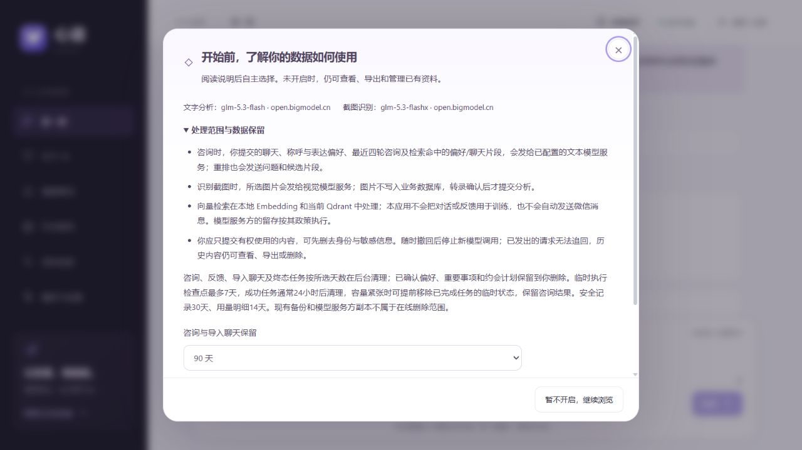

# 数据处理选择与在线保留

在首次咨询、截图转录或约会生成前，网页展示当前文本/视觉模型名称与服务域名，以及提交内容、最近四轮对话和检索片段的处理范围。复选框默认不选中，已有账号不会自动同意。未开启仍可查看、导出、删除和手动管理资料；关键词/向量检索预览留在本地。

说明与授权设置使用原生模态弹窗，正文不再嵌入整块卡片。未授权时进入聊天/约会页面会提示；关闭后可继续浏览，顶部“数据使用”可随时重开。发送、截图识别及任务重试在未授权时只打开说明，不提交内容、不清空草稿；选择保存成功后关闭。弹窗支持 Esc、关闭按钮及“暂不开启”，限制焦点与背景滚动，长说明在弹窗内滚动。

2026-10-28：前端 lint/build 通过；浏览器验证了关闭/重开、Esc 返回焦点、默认不勾选、确认按钮禁用、关闭后保留草稿与无正文占位。没有代替用户勾选授权；业务任务和模型调用均维持既有的一条合成验收记录。

`GET /api/relationship/privacy` 返回当前版本、模型目标指纹、选择及保留期限；`PUT` 必须带回当前版本和指纹。模型目标或说明变化后需重新阅读确认。选择按账号/访客空间隔离；注册保留原空间，登录其他账号不继承当前访客的选择。数据导出包含这些选择。

后端在任务入队、人工重试、截图入口、Worker 执行校验及每次实际模型 HTTP 请求前检查授权，不能只靠禁用前端按钮。撤回取消排队和执行中的任务，后续调用停止，已发出的请求无法追回；在途返回不能再保存咨询结果。截图转录返回前也重新检查授权。已保存内容仍保留，可另行导出或删除；账号注销删除选择本身。评测仅在随机独立合成数据库的 `evaluation` 环境跳过真实用户授权，常规测试环境不跳过。

## 保留范围

| 内容 | 在线保留规则 |
| --- | --- |
| 咨询、对应反馈、导入聊天、终态任务及其输入 | 每空间选择 30/90/180 天，默认 90 天 |
| 已确认偏好、重要事项、约会计划 | 用户手动删除；原咨询过期后解除来源链接，保留已确认摘录 |
| LangGraph 临时检查点 | 成功任务最后写入满 24 小时后清理，失败/孤立线程满 7 天后清理；不清理排队或运行任务 |
| 登录安全动态 | 30 天 |
| 模型用量明细/日计数 | 14 天；未结算预留不提前删除 |
| 已结束邮件投递记录 | 7 天；过期验证挑战额外保留一天后清理 |
| 登录会话 | 到期清理；Redis 会话缓存的 TTL 不超过原到期时间 |
| 已读/取消的提醒通知 | 30 天；未读及有效重要事项不因这个规则消失 |

Worker 每分钟在独立维护线程执行有数量上限的清理。使用数据库行锁，繁忙空间下轮处理；资料删除写入持久索引 outbox，Qdrant 暂时不可用时保留删除任务并重试。Worker 停机期间不能保证按时清理，恢复后继续；这是后台过期策略，不承诺精确到秒。缩短期限前界面提示先导出，因为过期内容会被移除。

终态任务的幂等记录与咨询采用相同保留周期，过期后不再承诺对旧请求编号无限期重放。账号关闭的最小哈希墓碑用于防止旧 Cookie 重建空间，不包含原聊天。在线删除、已有备份以及模型服务方副本是不同范围；备份生命周期与恢复删除过滤见 [加密备份与隔离恢复](./backup-recovery.md)。生产数据库最小权限、HTTPS 和密钥保管仍随用户后续部署执行，不能因本地功能检查通过而宣称已经满足全部生产或法规要求。

验收：`tests/test_privacy_retention.py` 覆盖未授权阻止生成/OCR、跨空间和配置变更、撤回取消任务、在途结果不落库、分空间保留、已确认摘录保留、索引删除 outbox、活动与失败检查点保留。新迁移 `ab3e94c520f1`；95 项本地回归、前端 lint/build 与 Alembic schema check 通过。浏览器已确认默认未勾选与禁用 AI 按钮，未替真实用户点击同意。
