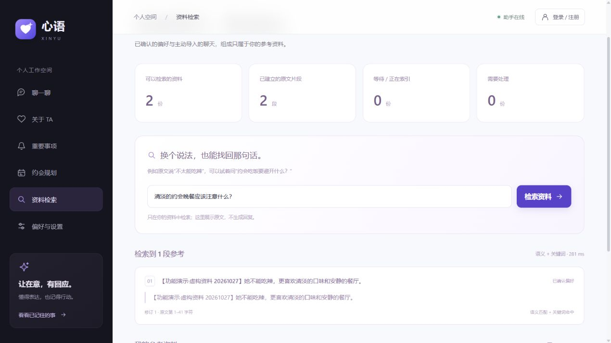
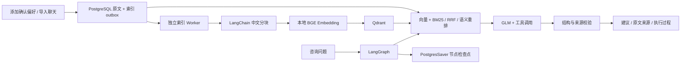
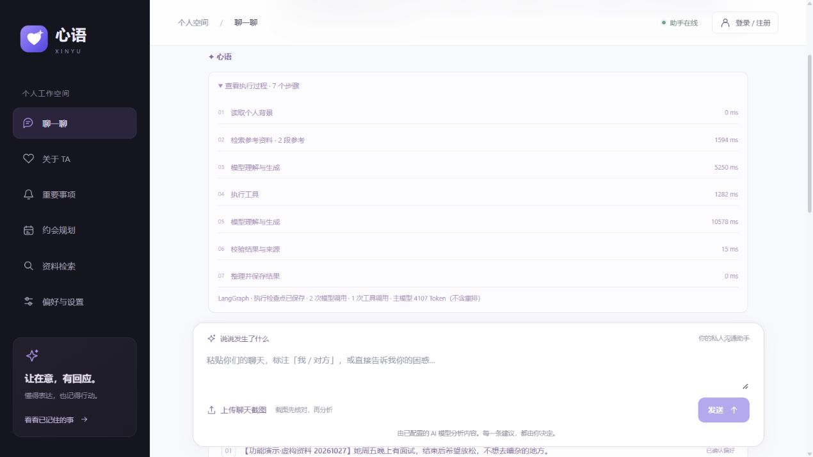

# RAG 与 LangGraph

更新：2026-10-27。网页入口为“资料检索”；新咨询默认使用 LangGraph，并在回答中展示实际参考来源及执行过程。



## 技术与作用

| 技术 | 当前用途 |
| --- | --- |
| LangGraph StateGraph | 读取背景 → 检索 → 模型调用 → 按需执行工具 → 校验 → 完成，使用条件边循环 |
| LangGraph PostgresSaver | 每个咨询请求的节点状态持久化，进程中断或模型失败后从检查点恢复 |
| LangChain RecursiveCharacterTextSplitter | 以中文标点和换行递归分块，保留原文字符位置；420 字符，重叠 70 字符 |
| FastEmbed / ONNX Runtime | 在本地 CPU 上运行 BAAI/bge-small-zh-v1.5，生成 512 维中文向量 |
| Qdrant | 持久化向量与资料元数据，按个人空间过滤，余弦相似度查询 |
| rank-bm25 | 中文二元字串和英文词项的关键词检索；不是 PostgreSQL 英文全文分词 |
| Reciprocal Rank Fusion | 合并向量与 BM25 的排名，避免直接相加不在同一尺度上的原始分数 |
| GLM 语义重排 | 对最多 16 段候选按问题相关性选序；只接受有效候选编号，失败保留原排序 |
| Pydantic | 校验最终结构化建议；来源编号必须对应当前仍有效的实际原文 |

FastEmbed 模型和缓存位于 `D:/DevTools/embedding-models`，无需额外 Embedding API Key，不安装 PyTorch；生成建议与语义重排仍使用现有 GLM 服务。LangSmith 是框架的间接依赖，当前没有启用远程追踪或上传私人对话。

## 完整流程



“资料检索”页预览混合检索结果，不调用生成模型或语义重排。Agent 回答时自动检索，也可以通过偏好、聊天或约会工具继续检索。检索不到资料时允许直接回答或补问，不生成虚构来源。

快速体验：在“资料检索”导入仓库里的 [虚构聊天示例](../examples/xinyu-demo-chat.txt)，等待状态变为“可以检索”，查询“晚餐应该避开什么？”。再到“聊一聊”提问“根据导入的聊天，周五面试结束后我该怎样约她吃饭？请参考原文”，查看来源卡片与执行步骤。示例不是已确认的真实偏好，可在设置的导入列表删除。

只有用户确认的 `memory` 和主动导入的 `chat_log` 会进入资料索引。候选偏好、模型回复、用户尚未核对的截图不自动成为事实。截图核对后的文本随咨询保存，但不会自动加入长期资料库；用户确认的偏好或另行导入的聊天才会进入索引。

## 索引一致性与数据隔离

`relationship_rag_indexes` 是 PostgreSQL 中的持久 outbox，创建、编辑、删除资料时与业务数据在同一事务中变更。API 不等待 Embedding；独立 Worker 领取索引任务，分批生成向量。前端显示等待、处理中、可检索和失败状态，可单条重试或重建。

检索先按服务端确定的 owner 过滤 Qdrant，再用 PostgreSQL 校验资料所属账号、有效状态、修订版本和原文位置。过期向量即使尚未物理移除，也不能作为有效来源返回。RAG 中的原文只是数据，不能覆盖系统规则；来源引用不能证明模型推断正确，用户仍可查看原文判断。

向量替换和删除使用幂等操作。资料修改会使旧版本立即失效，并触发重建；删除任务会清理当前及较早的本应用 Embedding 集合中的该资料。索引失败最多自动重试三次，再等待主动重试；删除清理失败每 30 秒重试，不以失败状态放弃清理。超时领取任务可恢复。并发编辑的旧任务不会覆盖较新的 outbox 状态。

向量、BM25 与重排仅在当前账号资料范围内运行。BM25 在内存中对最多 12,000 段最近资料计算；向量索引覆盖已成功处理的全部资料。向量服务或本地模型不可用时降级到 BM25，并在检索结果和执行详情中明确说明，不能把降级结果标为语义检索。

原文、向量、检查点均是私人数据，不进入 Git。清空个人空间会安排资料向量清理，同时删除该空间的 LangGraph 检查点。PostgreSQL、Redis、Qdrant 的 Docker 数据卷沿用 D 盘 Docker 存储；不改动旧科研备份目录。

## LangGraph 状态与恢复

节点：`load_context`、`retrieve_context`、`call_model`、`execute_tools`、`validate_answer`、`finalize`。最多八次主模型调用、六次实际工具执行，保留超时预算与结构修复分支。前端展示实际节点和工具耗时，不能当作模型隐藏推理过程。



检查点存于独立的 `xinyu_graph` PostgreSQL schema，与历史归档隔离。线程 ID 由服务端用 owner 和请求编号生成；重试相同请求从检查点继续，完成的状态不会重复调用模型或提出候选。Worker 的 PostgreSQL 请求去重与结果提交继续保留。

短期上下文来自最近四轮已保存对话；每个请求的执行状态由检查点恢复。跨请求长期偏好仍存于业务表，并经 RAG 检索，不能把每个请求的检查点当成长期知识库。重试恢复的是已保存的执行状态，不会主动刷新此前已完成的检索节点。

偏好和提醒仍在网页中由用户确认后保存。这一版本未使用 LangGraph `interrupt`/`Command` 构建图内人工审批，也没有引入多个自治 Agent。主模型 Token 计数只包括主工具循环，重排调用费用不包含在该计数里。

## 配置与运行

```dotenv
QDRANT_URL=http://127.0.0.1:6333
RAG_EMBEDDING_MODEL=BAAI/bge-small-zh-v1.5
RAG_MODEL_CACHE=D:/DevTools/embedding-models
RAG_RERANK_ENABLED=true
```

首次在新机器部署时，启动基础设施、应用迁移并下载本地模型：

```powershell
docker compose up -d postgres redis qdrant
uv run alembic upgrade head
uv run python -m scripts.prepare_ai --download-model
```

下载需要能访问模型托管平台。运行时默认只读取本地模型缓存，不因一次咨询触发联网下载；缓存未准备好时索引失败且检索明确降级。已有本地环境运行 `scripts/start.ps1`，会初始化检查点、集合并补齐已有偏好的索引任务。Qdrant 只映射本机 `127.0.0.1:6333`；当前不是已完成公开部署的服务。

数据库迁移为 `b15e60d7f945`；使用 `prepare_ai` 初始化 LangGraph 自身的表迁移。PostgresSaver 的表在独立 schema 中，不由应用 ORM 重复定义。备份需要同时包含 `public` 和 `xinyu_graph`，以及 Qdrant 卷；向量也可以从原文重建。

## 接口与主要代码

| 接口 | 用途 |
| --- | --- |
| GET `/api/relationship/knowledge` | 当前空间索引状态和资料列表 |
| POST `/api/relationship/knowledge/search` | 不调用生成模型的检索预览 |
| POST `/api/relationship/knowledge/reindex` | 重建当前空间有效资料索引 |
| POST `/api/relationship/knowledge/{id}/retry` | 重试当前空间的索引任务 |

主要文件：`relationship_rag.py`（分块、Embedding、索引、融合、重排与校验）、`relationship_agent.py`（LangGraph）、`relationship_tools.py`（工具）、`graph_checkpoints.py`（检查点）、`KnowledgePanel.tsx`（资料与检索预览）。

## 验证

使用合成资料和临时空间，实际验证本地向量入库、语义/混合检索、原文一致、账号隔离、BM25 降级、修改/删除使旧向量失效、outbox 清理、真实 LangGraph 节点及 PostgreSQL 检查点、完成状态复用、失败节点恢复和清空检查点，共16项。确定性图流程检查使用模拟生成模型；另通过现有真实 GLM 完成混合检索、工具调用与有效来源引用。浏览器中另用两条虚构资料实际完成混合检索、两次语义重排、七个执行节点与两段来源引用，主工具循环返回真实Token用量。临时资料随后清理。没有运行完整 pytest 套件。

参考：[LangGraph Graph API](https://docs.langchain.com/oss/python/langgraph/graph-api)、[LangGraph Persistence](https://docs.langchain.com/oss/python/langgraph/persistence)、[Qdrant FastEmbed](https://qdrant.tech/documentation/embeddings/fastembed/)、[Qdrant Hybrid Queries](https://qdrant.tech/documentation/concepts/hybrid-queries/)。
