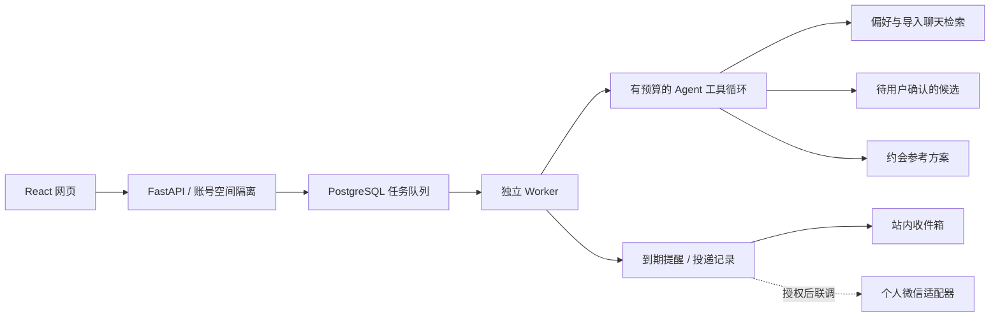

# 心语 Xinyu：网页基础版

更新日期：2026-10-26。入口：http://localhost:5173/assistant 。本轮用户已明确选择“先完成网页，微信接口准备好即可”。模型微调属于后续优化。

## 功能与边界

| 功能 | 实现 |
| --- | --- |
| 文字沟通分析、回复建议 | 后台调用现有模型，结果持久化；可复制，不能代发给伴侣 |
| 截图 | 最多两张PNG/JPEG，每张4MB；调用GLM-5.3-FlashX转录，先核对再分析 |
| 偏好 | 有来源的候选必须由用户确认；可手动添加、修改、删除 |
| 检索 | 全量偏好的关键词/词组召回；最多60条候选，超过8条时使用模型语义重排；不宣称使用向量数据库 |
| 工具调用 | 最多6次工具、8轮模型循环；展示真实名称、结果和耗时 |
| 后台咨询 | PostgreSQL持久队列，独立Worker；刷新/关闭网页后仍可继续；失败可重试，重复请求去重 |
| 重要事项 | 指定带时区时间、改期、取消、完成；每次修订有版本号 |
| 提醒 | 独立Worker到期生成持久收件箱记录；同事项同版本不重复；取消/改期使旧未读提醒失效 |
| 系统通知 | 用户开启权限后，打开页面时显示；没有实现关闭浏览器后的Web Push |
| 约会规划 | 收集区域、预算、日期、限制，读取已确认偏好；生成参考方案，可保存并添加准备提醒 |
| 账号 | 用户名和scrypt密码哈希；随机HttpOnly/SameSite会话，服务器只存会话摘要；注册保留访客数据，登录打开已有空间 |
| 跨设备 | 连接同一后端并登录同一账号；当前服务器默认仅本机监听，并非已发布的公网服务 |
| 聊天导入 | 用户主动上传UTF-8 TXT/JSON（最大1MB）；工具按原文片段检索，支持删除 |
| 数据管理 | 导出本空间数据；清空对话、事项、提醒、任务和导入记录，保留账号及表达设置 |
| 个人微信 | 官方协议适配接口已准备；本轮没有扫码，没有真实收发验收 |

不读取用户与伴侣的其他微信窗口或本地加密数据库。没有自动预订、支付、心理诊断或模型微调。账号暂不支持密码找回。

## 架构



新恋爱模块复用FastAPI、SQLAlchemy与模型Provider；采用独立的有界工具循环。原科研模块的LangGraph流程继续保留，不能把它算作恋爱模块已接入LangGraph的证据。

主要文件：

- `app/services/relationship_agent.py`：偏好、事项、聊天检索、候选、约会工具；最终结构化输出。
- `app/services/relationship_jobs.py`、`scripts/worker.py`：任务租期恢复、执行、到期提醒。
- `app/services/relationship_auth.py`：注册、登录、会话、尝试频率限制。
- `app/services/relationship_vision.py`：转录与图片大小/格式校验。
- `app/services/relationship_weixin.py`：微信协议、授权、文本收发及提醒投递准备。
- `app/routers/relationship.py`：账号范围内的API。
- `admin-ui/src/pages/RelationshipPage.tsx`、`RelationshipPage.css`：五个页面视图与统一设计。

## 配置与运行

私有 `.env` 内填写文本模型配置。视觉模型可复用原地址/Key，或通过下面三个独立参数指定：

```dotenv
RELATIONSHIP_VISION_MODEL=glm-5.3-flashx
RELATIONSHIP_VISION_BASE_URL=
RELATIONSHIP_VISION_API_KEY=
```

模型变更后重启API。图片原图只用于转录请求；用户核对的文字随咨询保存。模型服务商会收到所提交的内容。

Windows：`scripts/start.ps1` 启动本机数据库依赖、API、Worker和前端；`scripts/stop.ps1` 只停止匹配进程记录的应用及子进程，不删除数据。日志位于忽略目录 `.runtime/logs`。运行时和依赖缓存在D盘。

迁移版本：`e82b3da4c612`。保留所有原科研表与数据。`.runtime` 包含私有附件、进程日志和可选微信加密密钥，不得推送到GitHub。

## 微信接口准备

参考 [腾讯官方协议](https://github.com/Tencent/openclaw-weixin/blob/main/docs/protocol.md)，当前准备文本消息，不声称已覆盖微信图片、语音或全部平台能力。

| 接口 | 用途 |
| --- | --- |
| POST `/api/relationship/weixin/login` | 已登录账号主动获取授权二维码内容 |
| POST `/api/relationship/weixin/login/status` | 查询授权状态、提交可选验证码 |
| DELETE `/api/relationship/weixin` | 解除本应用绑定 |
| POST `/api/relationship/notices/{id}/retry` | 用户主动重试微信投递 |

凭据加密后存数据库，密钥保存在 `.runtime/secrets/weixin.key`，不得公开；未绑定时Worker不访问微信。只处理授权扫码者与助手的直接文本消息，不访问其他私聊。上下文过期拒收为 `needs_activity`；网络未确认成功为 `uncertain`，不自动重发，避免重复打扰。`accepted`仅表示平台接受，不等于已读。真实授权、扫码二维码展示与跨天投递尚待用户选择接入时联调。

## 验收证据

使用虚构数据、临时账号完成以下实际验证，数据随后已清理：

1. 注册保留访客偏好，第二个HTTP会话登录后访问同一空间；退出不影响其他合法会话。
2. 关闭页面轮询期间，Worker到期生成提醒；其他空间不能操作该提醒；取消事项后旧提醒失效。
3. 实际模型任务调用 `search_memories`、`propose_memory`，生成待确认候选；确认后保存。
4. 实际模型调用 `plan_date_context`，返回约会方案，用户确认保存成功。
5. 同请求编号去重、数据导出、会话退出。
6. GLM-5.3-FlashX识别合成聊天截图成功，HTTP转录端点返回两方原文；图片不是用户私人聊天。
7. Ruff、ESLint、TypeScript/Vite构建通过。浏览器检查桌面、390px窄屏及页面导航；修正了装饰图形的横向溢出。

没有运行完整pytest套件。没有真实微信账号授权，因此微信接口不能算“真实收发已完成”。
