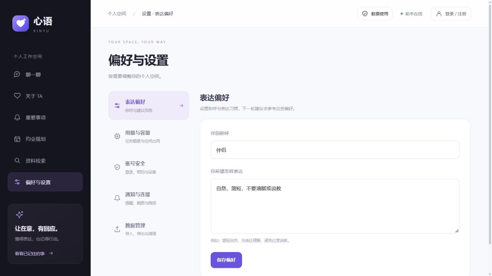

# 设置分区导航

原来的单页设置按使用目的拆为五个独立网址，默认打开表达偏好。旧 `/assistant/settings` 链接继续可用；分区点击、地址刷新、前进/后退和页面标题保持同步。

| 分区 | 路径 | 内容及后端对应 |
| --- | --- | --- |
| 表达偏好 | `/assistant/settings/preferences` | 伴侣称呼、建议风格；沿用 `/state` 与 `PUT /profile` |
| 用量与容量 | `/assistant/settings/usage` | 任务/Token 额度、执行预留、分类容量；沿用 `GET /usage` |
| 账号安全 | `/assistant/settings/account` | 登录/注册与现有账号安全弹窗，密码、设备、找回邮箱、登录记录、注销功能继续由原接口处理 |
| 通知与连接 | `/assistant/settings/connections` | 浏览器通知、后台提醒状态、截图配置状态、微信连接状态；不会自动申请权限或发起微信授权 |
| 数据管理 | `/assistant/settings/data` | 聊天文件导入、分页列表、查看原文、删除、数据导出、授权/保留入口与确认清空 |

常规浏览设置不再请求聊天文件列表；只有数据管理分区加载 `chat_log` 元数据，原文仍在用户点击后按需读取。导入与检索之间有直接链接，分页按钮留在文件列表中。清空操作集中在独立区域，仍需再次确认。账号或分区改变时重置本地清空确认状态，避免把旧空间的确认带入新空间。

数据使用说明继续使用原生弹窗，顶部始终有入口；进入设置不会重新嵌入长说明。表达偏好的未保存草稿留在父组件中，切换分区不自动提交。页面不展示服务脚本或密钥配置细节，实际配置仍在本地管理。

2026-10-28：前端 lint/build 通过；浏览器逐项检查五个分区，验证深链接刷新和浏览器后退定位。没有触发通知权限、微信授权、账号修改、资料删除或模型请求。

