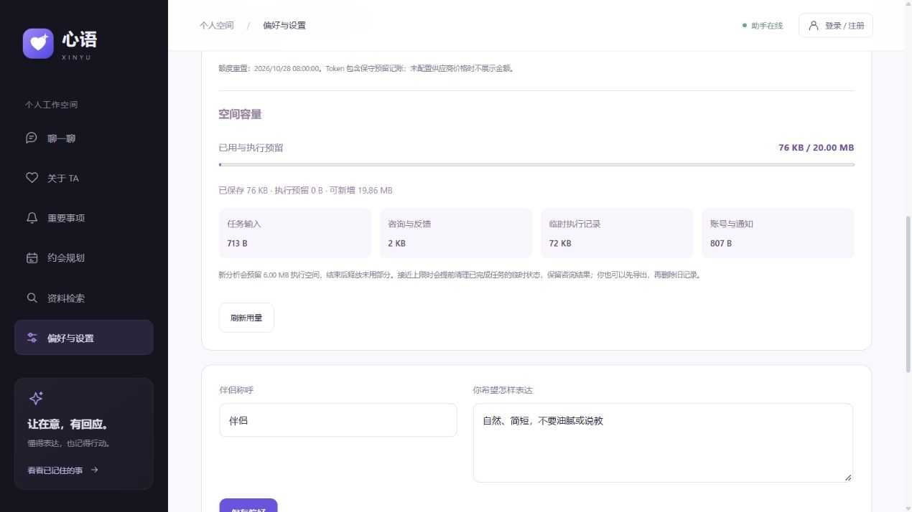

# 空间容量与执行预算

业务数据、图检查点及元数据现在共用 PostgreSQL 原子记账，设置页显示分类用量与执行预留。该预算衡量业务行的逻辑 JSON 字节，不是磁盘文件大小，也不是已验收的生产容量。

## 默认边界

| 配置 | 默认值 | 含义 |
| --- | --- | --- |
| OWNER_STORAGE_BYTES | 20 MiB | 单空间的逻辑字节及执行预留总额 |
| GLOBAL_STORAGE_BYTES | 512 MiB | 全空间合计，另含无法归属用户的安全元数据 |
| JOB_STORAGE_RESERVE_BYTES | 6 MiB | 每个排队或运行中的分析预留执行空间 |
| GRAPH_THREAD_STORAGE_BYTES | 4 MiB | 单任务检查点、blob、write 合计上限 |
| AGENT_RESULT_BYTES | 1 MiB | 单次分析结果 JSON 上限 |
| STORAGE_EMERGENCY_BYTES | 64 KiB | 单空间为会话、结算、终态及删除控制信息留出的余量 |
| GLOBAL_PROFILE_LIMIT | 10,000 | 全局访客/账号空间数量上限，非实际服务能力承诺 |
| OWNER_ITEM_LIMIT / GLOBAL_ITEM_LIMIT | 500 / 20,000 | 资料及事项数量限制，独立于字节预算 |

全局控制余量为单空间余量的 128 倍与全局额度 5% 的较小值；单空间余量不超过额度 5%。普通写入不能使用该余量，必要的会话与结算等写入仍受硬上限约束。若管理员把额度降到现有用量以下，不删除旧内容；新增长被拒绝，缩小写入与清空仍可执行。应在降低额度前检查保留的用量/安全元数据和系统余量，避免令必要控制写入也无法落盘。

## 记账范围与事务

- 所有 `public.relationship_*` 业务行（四张记账控制表除外），以及 `xinyu_graph` 的 checkpoints、checkpoint_blobs、checkpoint_writes。
- 分类显示资料、咨询/反馈、任务输入、临时执行记录、账号/通知。按 PostgreSQL `octet_length(to_jsonb(row)::text)` 计数，包括 JSON 结构与字段开销；bytea 的 JSON 表示可能比原始二进制大。
- 数据库触发器同时保护 SQLAlchemy 和原生 psycopg 的图写入。BEFORE STATEMENT 先取得容量锁，AFTER ROW 同事务调整计数与检查边界；超额时原语句回滚，不会只更新部分计数。
- 网页和核心 Worker 的显式行锁先取得容量锁，再锁具体业务行；队列、日额度及删除日志锁在容量锁之后。长模型请求、Embedding 和 Qdrant 调用不占用这些核心容量事务。
- 入队即预留预算，后续图、模型调用记录、最终结果写入消耗预留；完成、失败或取消释放剩余部分，删除/过期释放已用部分。重启重建计数保留活跃任务的实际剩余预留，不重复收费或预留。
- LangGraph 使用 `durability="sync"`。保存失败时先停止，不会在异步保存报错前继续后续模型步骤；容量错误不自动反复调用模型，失败任务的临时图会清理。
- 容量紧张时可提前删除已成功任务的临时图，保留用户可见咨询结果。空间清空和保留维护在同一数据库事务删除业务行与图。
- 提醒每批至多 100 条；已生成记录不占下一批名额。单空间容量失败使用保存点隔离，并通过 Redis 暂缓 60 秒，避免阻塞其他空间。暂缓期间提醒尚未生成，清理容量后自动再尝试。

数据库容量锁会串行化短写事务。这是当前单机方案的正确性取舍，不代表可支持任意多 Worker。尚未授权启用的微信通道不在本轮网页/后台链路的并发验收范围，启用前仍需独立投递与故障验证。

## 运维与物理存储区别

`GET /api/relationship/usage` 只返回当前空间的分类与预算。私有 `GET /api/ops/status` 新增 `storage`，包含全局逻辑记账、预留、`pg_database_size` 和工作区文件系统剩余空间，无用户标签、路径或聊天内容。逻辑用量达 90% 报 `LOGICAL_STORAGE_HIGH`；工作区剩余低于 2 GiB 与总量 5% 的较大值报 `WORKSPACE_DISK_LOW`。这些是本地运维告警，没有自动外发通知。

逻辑预算不覆盖索引膨胀、WAL、Qdrant 文件、模型缓存、日志、备份或四张记账控制表自身。数据库大小也不包含全部 PostgreSQL/WAL 文件。工作区所在磁盘的余量仅适用于该文件系统；若 Docker 数据迁往其他盘，需要另外监控。向量点位预算、日志/备份物理占用控制和完整链路压力测量仍未完成，不以本次数据库限额替代这些项目。

## 迁移、恢复与验收

迁移 `f18be2a6d405` 安装控制表/触发器并回填旧行与图，无用户内容删除。新安装图表后会补装触发器并重建记账。恢复演练先验证加密备份中所有表的原始指纹，再在独立恢复库应用删除意图与保留策略，最后重建容量计数；业务库不作就地覆盖。

2026-10-27：15 项容量专项与 8 项可观测性检查通过。专项包括八并发写入不可超额、全局跨空间回滚、真实图保存失败只调用一次模型、活跃任务重启预留不变、原生续租与取消不死锁、超大结果清理、旧版本迁移保留超额历史、清空释放、提醒分批/满额隔离。均使用独立 PostgreSQL/Redis 与合成数据，没有额外真实模型调用。

本地业务迁移后逐行独立核对计数一致，Alembic check 通过，API/Worker/Qdrant/Redis/PostgreSQL 就绪；页面容量展示已检查。迁移前备份及迁移后备份仅在 D 盘私有运行目录。迁移后真实隔离恢复验证 27 张表、58 条图记录、2 个本地密钥，临时库/向量集合清理成功；该现场集合为 0 个向量点，非空向量恢复由既有合成集成检查覆盖。

