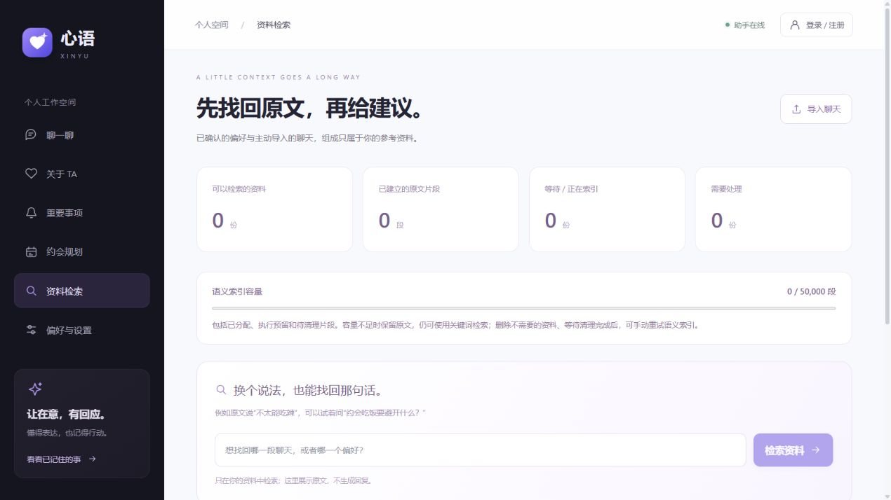

# 向量索引容量与并发清理

语义索引现在先分配点位预算，再计算 Embedding 和写入 Qdrant。资料检索页展示当前空间的分配量；超额资料标为“索引容量不足”，原文保留，关键词检索仍覆盖完整资料，不静默截断。

## 边界与状态

| 配置/字段 | 默认值或含义 |
| --- | --- |
| OWNER_VECTOR_POINTS | 单空间 50,000 个点位 |
| GLOBAL_VECTOR_POINTS | 全局 250,000 个点位 |
| reserved_points | 已有向量、执行预留及尚未确认清理的占用 |
| quota_blocked | 容量或归属核对阻止了新增索引；不会自动反复计算 Embedding，可清理后手动重试 |
| audited_points / audited_at | 最近一次完整核对的实际点数与时间，非实时计数 |
| untracked_points | 不能安全归属到资料的点数，计入全局占用并阻止新增额度 |

点位数量不是磁盘容量。512 维 float32 的原始向量长度只是开销的一部分，还存在原文 payload、图索引、存储段及临时合并文件。此处不能推导“只使用多少 MB”，也不构成生产并发或磁盘 SLA。

## 写入与删除

`92c71a0ed683` 为索引任务新增点位分配，并在 PostgreSQL 触发器内检查空间与全局额度。沿用容量锁，在同事务内完成分配与拒绝；并发的 SQLAlchemy/原生 SQL 写入不能绕开该准入检查。`0c58ad62f901` 进一步允许索引处理中/容量阻止状态使用已预留的控制信息余量，仍不能越过数据库容量硬上限；错误使用固定短文本，避免接近上限时连失败状态都写不下。迁移保留旧内容，先按既有成功片段回填，启动准备再核对实际向量，包括旧模型集合和失败任务残留。

修改、重试、删除只改变任务状态，不提前清零占用。替换前分配新旧需求的较大值；移除所有受管集合中的该资料向量，并用精确计数确认归零后，才缩减分配或释放额度。分批写入中断时，已计划的额度继续占用；重试、删除或完整核对后再释放，不把“请求已发出”当作“数据已删除”。

同一资料只允许一个索引 Worker 进入。它使用独立 PostgreSQL 自动提交连接的会话锁；编码和 Qdrant 请求期间，不持有 SQL 写事务、业务行锁或全局容量锁。资料本身仍可修改或删除，索引 Worker 在每批编码后检查任务代次、修订和来源状态，失效后清理并让新任务接续。连接关闭会释放锁；中断后的任务可重新领取，反复中断三次后需手动重试。

Qdrant 写入/删除请求使用 `wait=true` 和强顺序；检索结果始终按 SQL 中的 owner、修订、原文位置重新验证。PostgreSQL 与 Qdrant 不是同一原子事务：极端网络分区、进程冻结或人工直写可能使物理点数暂时偏离账本，不能宣称跨数据库严格原子或恰好一次。SQL 校验防止旧资料成为有效引用，周期核对修复占用与残留；不以账本值冒充即时物理计数。

## 核对与告警

启动准备和 Worker 维护会核对容量，维护间隔至少 300 秒，索引繁忙时跳过该次核对。核对与所有索引写入互斥；分页只读取 owner/source_id 元数据，不读取原文和向量。扫描每页 1,000 点，扫描阶段超过 60 秒或扫描/精确计数不一致就失败，不发布半份结果；数据库发布阶段仍受 SQL 超时控制。

可以归属但来源已不存在的残留，会生成持久删除任务；成功索引记录发现缺少向量时重新安排。已注销空间出现可归属残留，会撤销“清理完成”标记，重新完成删除闭环。不能确认归属的点不会自动删除；记录数量并告警，管理员核对受管集合的归属后处理，再重新运行准备步骤。降低额度不会抹除已有向量，只限制增长；清理确认后可继续分配。

私有运维接口 `storage.vectors` 返回全局分配量、最近核对实际点数、未知点数及核对年龄。新增告警 `VECTOR_INDEX_BLOCKED`、`UNATTRIBUTED_VECTORS`、`VECTOR_AUDIT_REQUIRED`、`VECTOR_AUDIT_STALE`（超过 900 秒）。没有外部通知发送。

适用前提：所有应用 Worker 运行相同版本，使用同一业务数据库、直连 PostgreSQL 和本应用独占的 Qdrant 受管集合。升级前停止旧版 Worker；不支持混用旧版不加锁的写入者，也不能通过事务池模式的连接代理保持会话锁。生产部署、最小权限和异常操作处置仍随后续部署验收。

## 验证

2026-10-28：新增 12 项真实 PostgreSQL/Redis/Qdrant 专项；全套 134 项通过，Ruff、前端 ESLint/TypeScript/Vite 构建通过。覆盖八并发原子准入、全局额度、Embedding 前拒绝、完整关键词回退、同资料双 Worker、编码中修改/删除、实际部分写入后中断、删除返回成功但未真正清除、孤儿与未知归属、核对中断不发布、注销回执重新清理、下调额度保留旧向量，以及容量接近上限时仍能保存索引失败状态。Embedding 使用确定性模拟，无额外模型 API 费用。

本机迁移与 Alembic check 已通过，网页实际展示容量条，API/Worker/依赖就绪。现场业务集合为零点，不能拿空集合检查代替上述非空故障检查。物理空间增长控制和完整 HTTP/模型/队列链路压力验收仍待后续工作。

参考：[PostgreSQL 会话锁与事务锁](https://www.postgresql.org/docs/18/functions-admin.html#FUNCTIONS-ADVISORY-LOCKS)、[Qdrant 点写入的 wait/ordering 参数](https://api.qdrant.tech/api-reference/points/upsert-points)。
